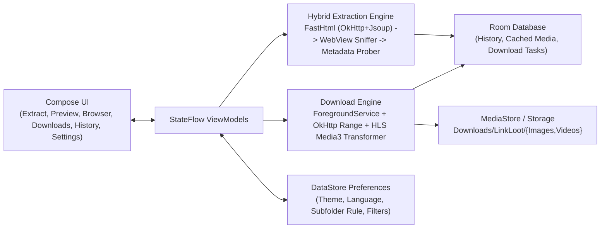
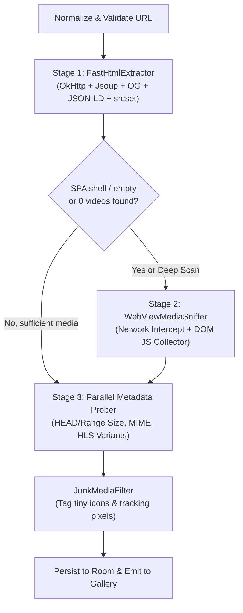

# LinkLoot Implementation Plan

## Goal Description
Build **LinkLoot**, a modern, sleek native Android application in **Kotlin** and **Jetpack Compose (Material 3)** that allows users to enter or share any website URL, analyze the page to discover images and videos, preview them with rich metadata, and download single or multiple files into organized subfolders under `Downloads/LinkLoot` with full pause/resume support and persistent extraction history.

Based on workspace inspection ([`app/build.gradle.kts`](../app/build.gradle.kts) and [`gradle/libs.versions.toml`](../gradle/libs.versions.toml)), the project is currently a starter Jetpack Compose app (`com.modatherali.linkloot`, `minSdk = 24`, `targetSdk = 35`, `compileSdk = 35`, AGP `8.13.1`, Kotlin `2.2.21`, Compose BOM `2025.05.00`).

---

## User Review Required

> [!IMPORTANT]
> **Platform Constraints, Permissions & Security Notes:**
> 1. **DRM & Anti-Bot Protected Sources:** Encrypted DRM streams (e.g., Widevine, FairPlay, key-protected private HLS streams) and anti-bot/CAPTCHA gates cannot be bypassed automatically. When a website requires login, cookie consent, or manual scrolling to load media, users can switch to the built-in **Interactive Browser** to interact manually while LinkLoot captures loaded media assets.
> 2. **Cleartext HTTP Media (`http://`):** Some older blogs and image hosts still serve media over `http://`. We will add a scoped `network_security_config.xml` permitting HTTP media retrieval/playback when needed while preferring HTTPS by default.
> 3. **Android Permissions:**
>    - `INTERNET`, `ACCESS_NETWORK_STATE`
>    - `FOREGROUND_SERVICE`, `FOREGROUND_SERVICE_DATA_SYNC` (keeps active downloads alive in the background)
>    - `POST_NOTIFICATIONS` (runtime permission on Android 13+ / API 33+ for live download progress notifications)
>    - `WRITE_EXTERNAL_STORAGE` (`android:maxSdkVersion="28"`, requested only on Android 7–9 devices; Android 10–15 uses scoped `MediaStore.Downloads` without broad storage permission prompts)

---

## Architecture & Agreed Decisions



### Key Design Decisions
1. **On-Device Hybrid Extraction Engine:** Fast initial pass with `OkHttp + Jsoup` (HTML tags, `OpenGraph`, `Twitter Cards`, `JSON-LD`, `srcset`, `<video>`, `<picture>`, inline script/style URLs), automatically escalating to a hidden `WebView` DOM + network sniffer for JS-rendered SPAs/embeds when needed, plus an optional **Interactive Browser** for login-gated or scroll-loaded pages.
2. **Video & Stream Formats:** Direct downloads (`MP4`, `WebM`, `MOV`, `GIF`) plus unencrypted **HLS (`.m3u8`)** master/media playlist parsing, quality variant selection, segment-level checkpointed downloading, and local `MP4` muxing via **Media3 `Transformer`**.
3. **Progressive Metadata Probing & Filtering:** Display discovered media immediately while parallel `HEAD`/`Range` requests populate file size, MIME type, format, and resume support. Small UI icons and tracking pixels (`< 100×100 px`, `1x1` spacers, favicon/sprite assets) are filtered by default with a one-tap toggle to show all.
4. **Download Storage & Subfolder Sorting:** Save files via `MediaStore.Downloads` into `Downloads/LinkLoot/Images` and `Downloads/LinkLoot/Videos` by default, with a Settings option to group by website domain (`Downloads/LinkLoot/<domain>/Images|Videos`).
5. **History Caching & Privacy:** Cache discovered media items per analyzed link in Room DB so reopening from History is instant and offline-friendly (with a Re-scan button), plus Settings controls to clear history and WebView cookies/cache.
6. **Localization & Visual Identity:** Bilingual **Arabic + English** UI following device locale by default with an in-app language switcher and full RTL/LTR support. Custom **LinkLoot Tech Palette** (Deep Obsidian/Slate dark surfaces, crisp light surfaces, Electric Cyan/Teal accents) with Light/Dark/System theme mode and an optional Material You (`dynamicColor`) toggle.
7. **Navigation & Entry Flows:** 3 primary bottom tabs (**Extract**, **Downloads**, **History**) + top-bar Settings button, plus Android Share Sheet (`ACTION_SEND`), Deep Link (`ACTION_VIEW`), and smart clipboard paste chip.

---

## Proposed Changes

### 1. Build Configuration, Dependencies & Manifest

#### [MODIFY] `gradle/libs.versions.toml`
Add version catalog entries compatible with Kotlin `2.2.21` and Compose BOM `2025.05.00`:
- **Plugins:** `ksp = "2.2.21-2.0.5"`, `kotlin-serialization` (`"2.2.21"`)
- **Serialization & Coroutines:** `kotlinx-serialization-json` (`1.10.0`), `kotlinx-coroutines-android` (`1.10.2`)
- **Networking & HTML Parsing:** `okhttp` (`5.5.1`), `jsoup` (`1.24.1`)
- **Image Loading:** `coil3` (`3.6.3`: `coil-compose`, `coil-network-okhttp`, `coil-gif`, `coil-video`)
- **Video Playback & HLS Muxing:** `media3` (`1.9.2`: `media3-exoplayer`, `media3-exoplayer-hls`, `media3-ui`, `media3-transformer`, `media3-datasource-okhttp`, `media3-common`)
- **Local Persistence:** `room` (`2.8.4`: `room-runtime`, `room-ktx`, `room-compiler`), `datastore-preferences` (`1.1.7`)
- **UI & Navigation:** `navigation-compose` (`2.10.2`), `androidx-compose-material-icons-extended`, `androidx-appcompat` (`1.7.0`)
- **Testing:** `kotlinx-coroutines-test` (`1.10.2`), `okhttp-mockwebserver` (`5.5.1`), `room-testing` (`2.8.4`)

#### [MODIFY] `build.gradle.kts` & `app/build.gradle.kts`
- Register `ksp` and `kotlin-serialization` plugins.
- Configure KSP Room schema directory (`ksp { arg("room.schemaLocation", "$projectDir/schemas") }`).
- Wire all dependencies cleanly into `app/build.gradle.kts`.

#### [MODIFY] `app/src/main/AndroidManifest.xml`
- Declare permissions (`INTERNET`, `ACCESS_NETWORK_STATE`, `FOREGROUND_SERVICE`, `FOREGROUND_SERVICE_DATA_SYNC`, `POST_NOTIFICATIONS`, `WRITE_EXTERNAL_STORAGE` with `maxSdkVersion="28"`).
- Register `LinkLootApplication`, `android:localeConfig="@xml/locales_config"`, `android:networkSecurityConfig="@xml/network_security_config"`, and `FileProvider` for opening/sharing completed downloads on legacy devices.
- Register `DownloadForegroundService` with `android:foregroundServiceType="dataSync"`.
- Add `ACTION_SEND` (`text/plain`) and `ACTION_VIEW` (`http`/`https`) intent filters on `MainActivity` with `android:launchMode="singleTop"`.

#### [NEW] `app/src/main/res/xml/network_security_config.xml`, `file_paths.xml`, `locales_config.xml`

---

### 2. Core Dependency Container & Domain Models

#### [NEW] `LinkLootApplication.kt` & `di/AppContainer.kt`
- Lightweight manual DI container providing singletons: `OkHttpClient` (shared cookie jar/bridge, timeouts, user-agent interceptor), `LinkLootDatabase`, `SettingsRepository`, `ExtractionRepository`, `HistoryRepository`, `DownloadRepository`, `DownloadCoordinator`.

#### [NEW] `domain/model/MediaModels.kt`
Immutable domain models:
- `MediaItem` (`id`, `mediaUrl`, `resolvedUrl`, `type: MediaType`, `format`, `mimeType`, `width`, `height`, `fileSizeBytes`, `durationMs`, `qualityLabel`, `isHls`, `hlsVariants: List<HlsVariant>`, `isJunkFiltered`, `refererUrl`, `headers`, `thumbnailUrl`)
- `HlsVariant` (`url`, `width`, `height`, `bandwidthBps`, `codecs`, `label`)
- `ExtractionProgress` (`stage: ExtractionStage`, `messageRes`, `imagesFound`, `videosFound`, `isUsingWebView`)
- `DownloadTask` (`id`, `mediaUrl`, `fileName`, `subfolder`, `mediaType`, `status: DownloadStatus`, `bytesDownloaded`, `totalBytes`, `segmentsCompleted`, `segmentsTotal`, `savedUri`, `savedDisplayPath`, `errorMessage`, `createdAt`)
- `HistorySession` & `AppSettings`

---

### 3. Local Persistence (`data/local`)

#### [NEW] `data/local/Entities.kt`, `data/local/Daos.kt`, `data/local/LinkLootDatabase.kt`
Room database (`version = 1`) with three tables:
- `history_entries`: `id`, `pageUrl`, `normalizedUrl`, `domain`, `pageTitle`, `thumbnailUrl`, `imageCount`, `videoCount`, `lastAnalyzedAt`
- `discovered_media`: `id`, `historyId` (FK `ON DELETE CASCADE`), `mediaUrl`, `resolvedUrl`, `type`, `format`, `mimeType`, `width`, `height`, `fileSizeBytes`, `durationMs`, `qualityLabel`, `isHls`, `hlsVariantsJson`, `isJunkFiltered`, `refererUrl`, `headersJson`, `thumbnailUrl`
- `download_tasks`: `id`, `mediaUrl`, `pageUrl`, `domain`, `fileName`, `subfolder`, `mediaType`, `mimeType`, `isHls`, `status`, `bytesDownloaded`, `totalBytes`, `segmentsCompleted`, `segmentsTotal`, `tempPath`, `savedUri`, `savedDisplayPath`, `refererUrl`, `headersJson`, `errorMessage`, `createdAt`, `updatedAt`

#### [NEW] `data/local/SettingsRepository.kt`
`DataStore<Preferences>` repository backing:
- `themeMode`: `SYSTEM` | `LIGHT` | `DARK`
- `useDynamicColor`: `Boolean` (default `false`)
- `appLanguage`: `SYSTEM` | `AR` | `EN`
- `hideSmallMedia`: `Boolean` (default `true`)
- `minImageSizePx`: `Int` (default `100`)
- `subfolderStrategy`: `BY_MEDIA_TYPE` | `BY_DOMAIN_AND_TYPE`
- `maxConcurrentDownloads`: `Int` (default `3`)
- `autoFallbackToWebView`: `Boolean` (default `true`)

---

### 4. Hybrid Extraction Engine (`data/extractor`)



#### [NEW] `UrlNormalizer.kt`
- Extracts first valid HTTP/HTTPS URL from shared text blocks (e.g., social share text containing title + URL), normalizes missing schemes (`https://`), and extracts sanitized domain names.

#### [NEW] `FastHtmlExtractor.kt`
- Fetches target HTML with `OkHttp`, follows redirects, captures response `Cookie` headers and final resolved URL (`Referer`).
- Parses with `Jsoup`:
  - `og:image`, `og:image:secure_url`, `og:video`, `og:video:secure_url`, `twitter:image`, `twitter:player:stream`
  - Recursive `application/ld+json` traversal for `image`, `contentUrl`, `embedUrl`, `thumbnailUrl`
  - `` (`src`, `data-src`, `data-original`, `data-lazy-src`, highest-width URL from `srcset`) and `<picture><source>`
  - `<video>` (`src`, `poster`, `<source src type>`)
  - Inline `<script>` and `style="background-image:url(...)"` regex scan for unescaped (`\/`, `\u002F`) `.mp4`, `.m3u8`, `.webm`, `.jpg`, `.jpeg`, `.png`, `.webp`, `.gif` URLs.

#### [NEW] `WebViewMediaSniffer.kt`
- Headless `WebView` runner wrapped in `suspendCancellableCoroutine` with configurable timeout + idle settle detection.
- Intercepts `shouldInterceptRequest` to capture network requests matching media extensions or MIME hints (`image/*`, `video/*`, `.m3u8`).
- Periodically executes safe DOM inspection JS (`document.images`, `video`, `source`, `picture`, computed `backgroundImage`) and triggers gentle scroll passes for lazy-loaded media.
- Syncs `CookieManager` cookies so subsequent downloads and ExoPlayer previews authenticate identically.

#### [NEW] `HlsPlaylistParser.kt`
- Pure-Kotlin parser for `.m3u8` playlists:
  - Master playlists (`#EXT-X-STREAM-INF`): parses `RESOLUTION`, `BANDWIDTH`, `CODECS`, `NAME`, and resolves relative variant URLs.
  - Media playlists (`#EXTINF`): computes total `durationMs`, resolves segment URIs and `#EXT-X-MAP` init segments, and detects `#EXT-X-KEY` encryption (flagging DRM/encrypted streams cleanly in UI).

#### [NEW] `MediaMetadataProber.kt` & `JunkMediaFilter.kt`
- Bounded parallel coroutine probing (`Semaphore(6)`) using HTTP `HEAD` (with `Range: bytes=0-0` fallback on 405) passing session `Referer` & `Cookie` headers to populate `fileSizeBytes`, `mimeType`, `format`, and byte-range support.
- `JunkMediaFilter` marks `1x1` trackers, `< 100×100` icons, `favicon`, and UI sprite URLs as `isJunkFiltered = true` while preserving them for users who toggle "Show all".

---

### 5. Download Manager & Storage (`data/download`)

#### [NEW] `DirectFileDownloader.kt`
- Streams direct media (`MP4`, `WebM`, `JPG`, `PNG`, `WEBP`, `GIF`) to `filesDir/temp_downloads/<taskId>.part`.
- Supports true **Pause & Resume** via `Range: bytes=<bytesDownloaded>-` (`206 Partial Content`), gracefully restarting if a server returns `200` or `416`.
- Attaches `Referer`, `User-Agent`, and `Cookie` headers to bypass CDN hotlink blocks.
- Throttles Room progress writes (~300ms / 64KB) for smooth UI updates.

#### [NEW] `HlsDownloadEngine.kt`
- Downloads `.m3u8` media segments into `filesDir/temp_hls/<taskId>/` with per-segment checkpointing in Room (`segmentsCompleted / segmentsTotal`) so HLS downloads can also pause/resume across app restarts.
- Writes a local `local.m3u8` manifest pointing to downloaded segments and invokes **Media3 `Transformer`** (`ExoPlayerAssetLoader.Factory` + `DefaultMediaSourceFactory`) to mux into a clean `.mp4` output file.

#### [NEW] `MediaStoreSaver.kt`
- Resolves target relative folder under `Downloads/LinkLoot`:
  - `BY_MEDIA_TYPE`: `Download/LinkLoot/Images` or `Download/LinkLoot/Videos`
  - `BY_DOMAIN_AND_TYPE`: `Download/LinkLoot/<sanitized-domain>/Images` or `Videos`
- On API 29+: writes via `MediaStore.Downloads` with `RELATIVE_PATH`, `IS_PENDING = 1` -> `0`, and resolves filename collisions (`file (1).ext`).
- On API 24–28: writes to `Environment.getExternalStoragePublicDirectory(DIRECTORY_DOWNLOADS)/LinkLoot/...` and calls `MediaScannerConnection.scanFile`.

#### [NEW] `DownloadForegroundService.kt` & `DownloadCoordinator.kt`
- Manages a concurrent queue (default max 3 active jobs), global Pause All / Resume All, individual Pause / Resume / Retry / Cancel, and automatic temp-file cleanup.
- Publishes a grouped foreground progress notification with quick Pause/Cancel actions.

---

### 6. Theme, Localization & Jetpack Compose UI (`ui/`)

#### [MODIFY] `ui/theme/Color.kt`, `Theme.kt`, `Type.kt`
- **LinkLoot Tech Palette:**
  - Dark mode: Obsidian `#0B101B` canvas, Slate `#131B2E` cards, `#23304A` hairline borders, Electric Cyan `#22D3EE` primary, Mint Teal `#2DD4BF` secondary.
  - Light mode: Pearl `#F7F9FC` canvas, Pure White `#FFFFFF` cards, Deep Midnight `#0F172A` text, Deep Cyan `#0891B2` primary, Indigo `#4F46E5` secondary.
- Optional Material You (`dynamicColor`) toggle from Settings.
- Tabular numeric typography (`fontFeatureSettings = "tnum"`) for dimensions, sizes, durations, and speeds.

#### [MODIFY] `res/values/strings.xml` & [NEW] `res/values-ar/strings.xml`
- Full English and Arabic string resources with RTL-safe Compose layouts (`Arrangement.spacedBy`, `start`/`end` padding, `AutoMirrored` icons).
- Uses `AppCompatActivity` + `AppCompatDelegate.setApplicationLocales` in `MainActivity` for instant in-app Arabic/English switching across API 24–35.

#### [NEW] Screens & Components (`ui/...`)
1. **`ui/LinkLootApp.kt`:** Top-level Scaffold with 3 bottom navigation tabs (**Extract**, **Downloads** with active count badge, **History**), TopAppBar Settings icon, and responsive layout support across compact/medium/expanded screen widths.
2. **`ui/extract/ExtractScreen.kt` + `ExtractViewModel.kt`:**
   - Hero URL input card with smart clipboard URL detection chip, Paste/Clear actions, prominent **Analyze** button, and overflow menu (**Deep WebView Scan**, **Interactive Browser**).
   - Animated multi-stage extraction progress card with live counters and Cancel button.
   - Segmented Media Tabs (**All**, **Images (N)**, **Videos (N)**), Filter/Sort chips (Hide small icons, Sort by Size/Type/Default), and adaptive `LazyVerticalGrid` (`GridCells.Adaptive(156.dp)`).
   - Media cards with Coil thumbnails, type/quality badges (`MP4`, `HLS`, `WEBP`), video duration pill, resolution & file size footer, single-tap preview, and long-press / checkbox multi-select mode with sticky batch download bar.
   - HLS Quality Selector bottom sheet when downloading or previewing multi-variant streams.
3. **`ui/preview/MediaPreviewSheet.kt`:**
   - Full-screen swipeable `HorizontalPager` preview overlay.
   - Pinch-to-zoom & double-tap zoomable image viewer.
   - `Media3 ExoPlayer` video player backed by `OkHttpDataSource.Factory` (carrying `Referer` & `Cookie` headers), playback controls, seek bar, mute toggle, and variant selector.
   - Expandable metadata bottom sheet (resolved URL, dimensions, format, MIME, file size, duration, Copy Link, Download).
4. **`ui/browser/InteractiveBrowserScreen.kt`:**
   - Visible instrumented `WebView` with URL bar, Back/Forward/Reload, live floating pill counting intercepted images & videos, and **"Import Captured Media"** button.
5. **`ui/downloads/DownloadsScreen.kt` + `DownloadsViewModel.kt`:**
   - Segmented view for **Active Queue** (progress bar, bytes/total, status badge, Pause/Resume/Retry/Cancel, Pause All/Resume All) and **Completed Files** (open in external viewer, Share sheet, subfolder display path, Delete file or remove entry).
6. **`ui/history/HistoryScreen.kt` + `HistoryViewModel.kt`:**
   - Searchable list of analyzed links with domain, page title, thumbnail, relative timestamp, and image/video counts. Tap opens cached media immediately; actions for Re-scan, Copy URL, and Delete.
7. **`ui/settings/SettingsSheet.kt` + `SettingsViewModel.kt`:**
   - Theme Mode (System / Light / Dark), Material You toggle, App Language (System / English / Arabic), Subfolder Organization (`Images & Videos` vs `Domain + Type`), Small Icon Filter toggle, Concurrent Downloads slider (1–5), Auto WebView Fallback toggle, Clear History, and Clear Cookies & Cache.

---

## Verification Plan

### 1. Automated Tests
- **Unit Tests (`app/src/test`):**
  - `UrlNormalizerTest`: Scheme normalization, extracting URLs from shared strings, domain sanitization.
  - `FastHtmlExtractorTest`: Parsing `og:image`, `og:video`, `JSON-LD`, `srcset` resolution selection, `<video>`, and inline JSON-escaped URLs.
  - `HlsPlaylistParserTest`: Master variant resolution/bandwidth parsing, media segment duration summing, and `#EXT-X-KEY` encryption detection.
  - `JunkMediaFilterTest`: Filtering `1x1` pixels and `<100px` icons while keeping legitimate images.
  - `DirectFileDownloaderTest` (using `OkHttp MockWebServer`): Full download, interruption, and HTTP `Range: bytes=...` (`206`) resume verification.
  - Run build, lint, and unit tests:
    ```powershell
    .\gradlew.bat testDebugUnitTest lintDebug assembleDebug
    ```
- **Instrumented & Compose UI Tests (`app/src/androidTest`):**
  - Room DAO tests for `HistoryDao` (cascade delete, cached media lookup) and `DownloadDao` (status & progress updates).
  - Compose UI tests verifying Image/Video tab separation, multi-select batch bar, and RTL/LTR rendering.
  - Run on connected device (`b30cdde4`):
    ```powershell
    .\gradlew.bat connectedDebugAndroidTest
    ```

### 2. Manual Verification
Install the debug APK on the connected Android device (`b30cdde4`):
```powershell
C:\Users\modather\AppData\Local\Android\Sdk\platform-tools\adb.exe -s b30cdde4 install -r app\build\outputs\apk\debug\app-debug.apk
```
Verify end-to-end user journeys:
1. Paste a blog/store/gallery URL and share a URL from Chrome into LinkLoot; verify progress steps, Image vs Video tab separation, and icon filter toggle.
2. Open Image Preview (pinch-to-zoom) and Video Preview (ExoPlayer playback before download) and verify metadata fields (dimensions, format, size, duration).
3. Multi-select files, start batch download, pause and resume mid-download, and confirm output files exist in `Downloads/LinkLoot/Images` and `Downloads/LinkLoot/Videos`.
4. Test a JS-heavy site via automatic WebView fallback and Interactive Browser capture.
5. Reopen a previous entry from History offline, switch between Light & Dark themes, and switch between English (LTR) & Arabic (RTL).
